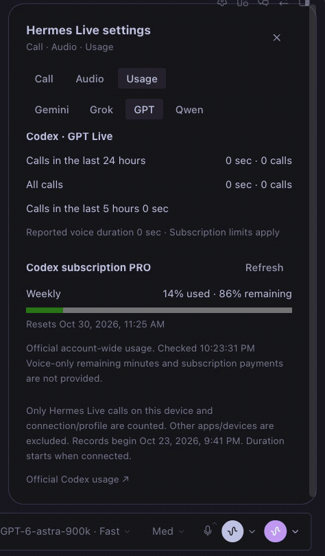

# hermes-live

**Hermes Desktop에서 Gemini·Grok·Qwen·Codex 구독 음성 통화를 사용하는 플러그인입니다.**

English: [README.md](./README.md)

공식 앱을 수정하거나 다시 빌드하지 않고 입력란에 통화 버튼을 추가합니다. 최근 채팅 맥락을 음성 모델에 전달하며, 파일 확인이나 작업 요청은 현재 Hermes 채팅에 위임합니다. 마이크·스피커 선택, 음소거, 실시간 자막, 제공자별 사용량과 예상 요금을 지원합니다.



영상은 v0.7.0의 기능 소개입니다. v0.9.0에서는 Hermes 공식 디자인 시스템에 맞춰 선택 상자, 탭, 간격과 인증 안내 배치를 정리했습니다.

## 요구 사항

- Hermes Desktop 및 백엔드 v0.22.5 이상
- 제공자 API 키 또는 백엔드 컴퓨터에 로그인한 Codex CLI의 ChatGPT 구독 계정
- 마이크 권한
- macOS에서 검증했습니다. Windows·Linux와 원격 백엔드의 전체 실통화는 아직 검증하지 않았습니다.

## 설치

### 방법 A — 복제 후 심볼릭 링크

```sh
git clone https://github.com/dandacompany/hermes-live.git ~/hermes-live
mkdir -p ~/.hermes/plugins
ln -s ~/hermes-live ~/.hermes/plugins/hermes-live
```

같은 이름의 설치 경로가 이미 있으면 링크 명령을 실행하지 마세요. 저장소에 빌드된 Desktop 파일이 포함되어 있습니다.

### 방법 B — GitHub에서 설치

```sh
hermes plugins install dandacompany/hermes-live
```

저장소 직접 설치입니다. 공식 카탈로그 등록은 심사 전이므로 카탈로그 이름만으로 설치하는 방법은 아직 안내하지 않습니다.

### 검증 및 활성화

```sh
hermes plugins validate ~/.hermes/plugins/hermes-live
hermes plugins enable hermes-live
hermes plugins list
```

Desktop의 Plugins에서 Rescan을 누르고 Hermes Live의 Desktop 스위치도 켜세요. 백엔드와 Desktop 활성화는 별개입니다. 백엔드 경로가 변경된 업데이트는 진행 중 작업이 끝난 뒤 백엔드를 재시작해야 합니다.

## 인증과 첫 통화

1. 입력란의 보라색 통화 버튼 옆 아래 화살표를 엽니다.
2. Call에서 제공자를 선택하고 Configure API key를 누릅니다.
3. Hermes의 비밀정보 설정에 해당 키를 입력하고 저장합니다. Qwen은 Workspace ID와 키에 맞는 지역도 설정합니다.
4. 통화 설정으로 돌아와 Refresh를 누른 다음 통화 버튼을 누릅니다.

한 제공자만 설정해도 사용할 수 있습니다. 미설정 상태는 마이크를 켜기 전에 확인합니다. 키가 설정되어 있어도 유효성·모델 권한·잔액은 연결할 때 확인합니다. 준비 중에는 Preparing이 표시되며 다시 누르면 취소됩니다. 연결되면 End로 바뀝니다.

Codex는 **백엔드 컴퓨터의 Codex CLI 계정**을 자동 감지합니다. 미설치·미로그인·API 키 로그인을 구분하고 로그인 명령과 공식 안내를 제공합니다. 해당 컴퓨터에서 `codex login`, 원격 또는 화면 없는 서버에서는 `codex login --device-auth`를 실행한 뒤 Refresh로 재확인하세요. 앱 안에서 OAuth를 직접 실행하지 않으며 구독 토큰을 입력받지 않습니다.

Hermes 자체 ChatGPT 계정과 Codex CLI 계정은 다를 수 있습니다. 이 플러그인의 구독 통화와 한도 조회는 같은 Codex CLI 계정을 사용합니다. OS 사용자와 CODEX_HOME이 같은 프로필은 계정을 공유할 수 있습니다. 원격 연결에서는 서버에 플러그인과 인증을 설정해야 하며, Desktop의 로그인 정보를 복사하지 않습니다.

## 오디오·사용량·언어

- Audio에서 마이크·스피커를 선택합니다. 장치 변경은 다음 통화부터 적용됩니다. 마이크 테스트는 최대 15초간 입력 크기만 표시하며 녹음하거나 전송하지 않습니다.
- Usage에서 통화 시간·횟수와 API 예상 요금을 확인합니다. 실제 청구액은 제공자 콘솔을 확인하세요. 무료 한도·할인·세금·Hermes 위임 작업 비용은 추정에 포함되지 않습니다.
- Codex는 계정 전체의 공식 사용률·남은 비율·초기화 시각을 보여줍니다. 음성 전용 잔여 분량이나 구독 결제액은 제공하지 않습니다.
- 인터페이스는 Hermes의 주 언어 설정을 따릅니다. 한국어·영어를 포함한 17개 언어를 지원합니다.

## 데이터와 알려진 제한

마이크 음성과 최근 채팅의 사용자·어시스턴트 텍스트가 선택한 제공자로 전송됩니다. 채팅은 최대 24개 메시지·6,000자이며 숨김 메시지와 도구 결과는 제외합니다. 작업 위임 시 요청과 최근 음성 맥락이 현재 Hermes 채팅으로 전달됩니다. 잡담 전체가 채팅 말풍선으로 저장되지는 않습니다.

API 키는 Hermes의 프로필별 비밀정보 경로로 읽으며 플러그인이 별도 키 파일이나 비밀 저장소를 직접 읽지 않습니다. 브라우저에는 단기 토큰 또는 WebRTC 연결 응답만 전달합니다. 장치 선택과 사용량은 Desktop 플러그인 저장소에, 통화 자막은 메모리에 유지합니다. 플러그인은 원본 오디오를 녹음하거나 자체 텔레메트리를 추가하지 않습니다.

Codex는 백엔드에 app-server 자식 프로세스와 임시 작업 폴더를 만들며 해당 사용자의 Codex 로그인과 설정을 사용합니다. 셸·앱·플러그인·훅·멀티에이전트와 상속된 MCP 서버는 음성 프로세스에서 비활성화합니다. 실제 작업은 Hermes가 수행합니다. 통화 종료 시 정리하며 창이 사라지면 약 55초 내에 정리합니다.

Hermes가 사용자 답변을 기다리는 위임 작업에서는 음성 응답이 계속 대기할 수 있습니다. 채팅에서 답변하세요. 다른 기본 음성 통화는 종료한 뒤 사용하세요. 채팅·프로필·연결을 바꾸면 통화가 종료됩니다.

카탈로그 승인은 아직 받지 않았습니다. Codex app-server 인증 경로는 카탈로그 정책 검토 또는 Hermes 자체 구독 인증 경로로의 별도 검증된 전환이 필요합니다. 네트워크 목적지·요금 기준·제공자별 검증 범위는 [영문 문서](./README.md)에 상세히 적었습니다.

## 빌드

Node.js 24에서 실행합니다.

```sh
npm ci
npm run typecheck
npm run build
hermes plugins validate . --install-deps
```

## 라이선스

[MIT License](LICENSE). 필요한 제3자 고지는 [NOTICE.md](NOTICE.md)에 포함되어 있습니다.

---
[Dante Labs](https://dante-labs.com) · [YouTube @dante-labs](https://youtube.com/@dante-labs) · [Email](mailto:dante@dante-labs.com) · [Discord](https://discord.com/invite/rXyy5e9ujs) · [Support](https://buymeacoffee.com/dante.labs)
