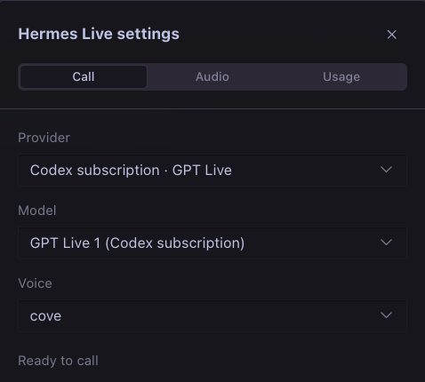
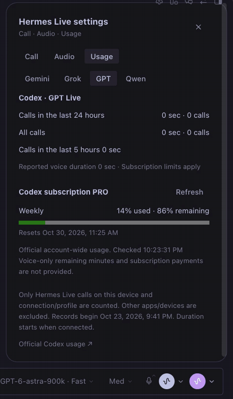
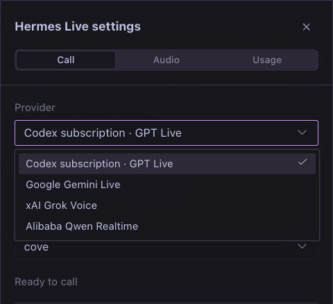
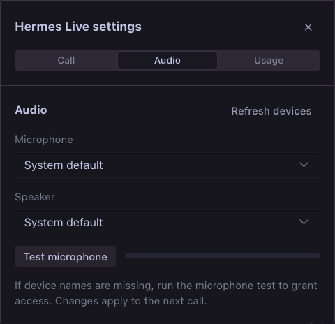
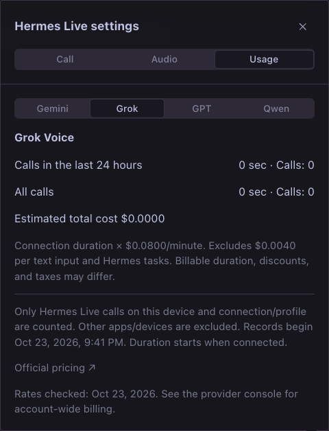
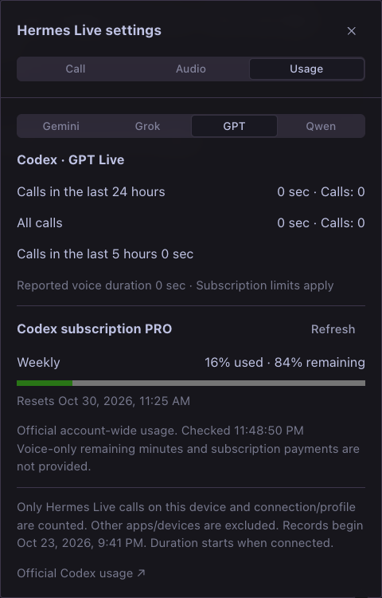

> **Apple Silicon 베타 0.11.5** — 귀 아이콘에 마우스를 올리거나 포커스한 뒤 **음성 기능 잠시 쉬기**를 누르면 Live 통화와 호출 대기가 종료됩니다. Hermes 기본 음성·받아쓰기를 마친 후 **호출 대기 재개**를 누르세요. 일시정지는 새로고침 후에도 유지되며 봇·목소리·마이크·자동 시작 선호는 보존합니다. 기본 음성 사용을 자동 감지하지 않습니다. 앱 전체 화면 감시 코드를 제거했으며 플러그인 검증 16개를 통과했습니다(백엔드 내부 API 참조 경고는 남음).

> 첫 설정: **설정 → 플러그인 → Hermes Live**에서 봇 선택 → 계정 → 호출 모델 → 마이크 → 직접 해보기 순서로 준비합니다. 버튼 통화만 사용하면 호출 모델을 받지 않습니다. 이름 호출은 Apple Silicon Mac / Hermes 0.23.0 이상을 지원합니다.
> 모델이 있으면 검증해 재사용하고, 없으면 약 488 MB Whisper Small을 내려받습니다. 실행 엔진은 포함되어 BotIn·Node.js·개발 도구 설치가 필요 없습니다. 다운로드 취소·재시도, 로그인·권한 안내를 제공합니다.
> 호출은 **헤이 {이름}**, 종료는 **바이 {이름} / Bye {이름}**입니다. 로컬 호출 테스트와 실제 구독 통화 테스트를 구분하며, 대기는 마지막에 직접 시작합니다. 기존 봇·목소리·모델 설정은 유지합니다. 자세한 설치 조건과 저장 위치는 [README](README.md#first-use-setup)를 참고하세요.

# hermes-live

**Hermes Desktop에서 Gemini·Grok·Qwen·Codex 구독 음성 통화를 사용하는 플러그인입니다.**

English: [README.md](./README.md)

공식 앱을 수정하거나 다시 빌드하지 않고 입력란에 통화 버튼을 추가합니다. 최근 채팅 맥락을 음성 모델에 전달하며, 파일 확인이나 작업 요청은 현재 Hermes 채팅에 위임합니다. 마이크·스피커 선택, 음소거, 실시간 자막, 제공자별 사용량과 예상 요금을 지원합니다.

귀 아이콘에 마우스를 올리거나 키보드로 포커스하면 Live 통화·설정 버튼이 펼쳐집니다. 대기 상태는 툴팁과 이름 호출 설정에서 확인하며, 통화 중 종료 버튼은 계속 표시합니다.

이름을 부르면 Sessions 화면에서도 Bots 탭으로 전환하고, 해당 봇의 고정 Bot Chat을 연 뒤 통화를 시작합니다. 기존 세션 탭은 유지하며 Desktop에서 Bots가 켜져 있어야 합니다.

## 베타 첫 설정의 남은 제약

간헐적인 프로필 전환 취소가 보고됐습니다. 이후 시험에서는 통과했지만 원인은 아직 확정하지 못했으며, 모든 전환 오류가 해결됐다고 주장하지 않습니다.

참여할 프로필마다 Hermes Live를 설치·활성화해야 합니다. 백엔드 플러그인이 없는 프로필에서 공용 설정 화면을 열면 현재는 미설치 안내 대신 일반 연결 오류가 표시됩니다.

통화 전에 **Hermes 설정 → 모델**에서 호출할 봇의 기본 대화 모델을 설정하세요. Codex 음성 계정 로그인만으로 봇의 기본 모델이 설정되지는 않습니다. 비어 있으면 새 대화를 만들 때 `storage_unavailable` 오류가 날 수 있습니다. 모델 설정 후 Desktop을 새로고침하고 재시도하세요. 현재 시작 화면은 이 조건을 자동 검사하지 않습니다.

Whisper는 이름을 다른 표기로 인식할 수 있습니다. 예를 들어 `테스트봇`이 `Testbot` 또는 `테스트보트`가 될 수 있으므로 **봇 선택**에서 발음 별칭을 추가하고 저장한 뒤 다시 테스트하세요. 로컬 테스트 화면에 실제 인식 문구를 보여주는 기능은 아직 없습니다. `헤이/Hey + 이름`을 모두 말한 뒤 잠깐 쉬어 주세요. 이름만 말하면 통화를 시작하지 않습니다.

이름 호출은 이제 각 봇의 기존 **Bot Chat**을 같은 자리에서 다시 엽니다. 종료 후 재호출하거나 다른 봇에서 돌아와도 대화를 이어가며, Bot Chat이 없는 봇만 처음 한 번 생성합니다. 조회 실패 시 새 대화로 대신 열지 않으며 기존에 생성된 별도 대화도 보존합니다.

0.11.5부터 Codex 통화를 시작할 때 이전 발화를 음성 입력으로 다시 보내지 않습니다. 기록은 고정 Hermes 대화에 유지하며, 짧은 첫 인사 후 대기합니다. 이전 대화에 대한 질문은 같은 Hermes 대화에 위임합니다.

종료는 통화 중인 음성 모델의 완료 전사문으로 판단하며 별도 Whisper를 돌리지 않습니다. 관측된 `by` 표기와 같은 종료어 반복을 허용합니다. “바이” 다음 3초 이내에 현재 봇의 정확한 이름·별칭만 별도 발화로 들어와도 종료합니다. 질문·인용·다른 봇·중간에 낀 사용자 문장·시간이 지난 조각은 종료하지 않습니다.

0.11.4에서는 통화 중과 로컬 호출 대기 모두에서 같은 호출어를 한 발화에 반복해도 인식합니다. 다른 말·질문·인용·서로 다른 봇 호출이 섞이거나 별칭이 중복되면 전환하지 않습니다. 음성 인식이 이름을 다르게 적으면 **봇 선택**에서 해당 표기를 별칭으로 추가하세요. 이름을 자동으로 추측하지는 않습니다.

0.11.3에서는 봇 전환 중 기본 연결로 잠깐 돌아오고 이전 봇 정보가 남는 순간을 취소로 오판하던 오류를 수정했습니다. 새 대화의 세션 ID가 없는 준비 단계만 허용하며, 무관한 소유자·연결·이미 생성된 세션에 대한 보호는 유지합니다. 종료어는 실제 음성 인식에서 관측한 `바일`·`파일`도 현재 봇의 정확한 이름·별칭과 단독으로 말한 경우에만 허용합니다. 파일 요청 문장·질문·인용은 통화를 종료하지 않습니다.

수동으로 호출 엔진을 설정했던 사용자는 **호출 모델**에서 기존 모델을 다시 확인한 뒤 마이크를 선택·저장해 포함된 엔진으로 전환하세요. 기존 모델은 재사용할 수 있습니다. 예전 개발용 엔진 경로는 이번 베타와 호환되지 않을 수 있습니다.

## 봇 이름으로 통화하기

**Live 통화 설정 → 이름 호출**에서 원하는 로컬 봇을 켜고 저장합니다. 봇 화면의 현재 이름(없으면 프로필 표시 이름)으로 `헤이 {이름}`을 부릅니다. 별칭은 최대 3개이며, 켜진 봇끼리 이름이 겹치면 저장하지 않습니다. 기존 설정은 유지하고 새 봇은 호출이 꺼진 상태로 표시합니다.

입력창의 **음성 호출 대기**를 켜면 로컬 Whisper 한 개가 선택한 이름들을 감지합니다. 이름을 부르면 해당 봇의 Codex 구독 통화를 시작합니다. `Bye {이름}` 또는 `바이 {이름}`으로 통화를 마치고 대기로 돌아갑니다. 통화 중 이름·별칭을 수정해도 현재 통화의 종료 인사는 유지하며 다음 호출부터 반영합니다.

Hermes Desktop 창과 마이크가 필요합니다. 0.11.0부터 설정 화면이 기존 모델을 탐색하고, 없으면 내려받아 준비합니다. 새 설치는 포함된 실행 엔진을 사용하므로 Node/외부 어댑터 경로가 필요 없습니다. 선택할 봇에도 Hermes Live를 켜고 Codex에 ChatGPT 계정으로 로그인해야 합니다. 다른 API 제공자로 자동 전환하지 않습니다. 호출 감지 음성은 로컬에서 처리하며 음성·전사문을 저장하지 않습니다. 원격 봇이나 종료된 앱을 깨우는 기능은 이 버전에 포함하지 않습니다.

선택과 별칭은 `~/.hermes/state/hermes-live/wake-bots.json`에 프로필 ID 기준으로 저장합니다. 마이크·모델은 봇별 설정이 없으면 로컬 기본 프로필 설정을 따릅니다. 입력창의 대기 토글을 끄면 마이크를 놓습니다.

## 미리보기

Hermes Desktop의 기본 선택 상자와 탭을 사용하는 v0.9.0 설정 화면입니다.



이전 v0.9.0 영문 화면을 순서대로 보여주는 GIF입니다. 보라색 통화 버튼은 저장된 설정으로 통화를 시작하고, 옆 화살표는 설정 패널을 엽니다.



| 네 가지 음성 제공자 | 마이크·스피커 설정 |
| --- | --- |
|  |  |
| **API 사용량과 예상 요금** | **Codex 구독 한도** |
|  |  |

2026년 10월 23일 Hermes Desktop v0.22.5와 Hermes Live v0.9.0에서 촬영했습니다. GIF는 실제 설정 화면을 엮은 애니메이션이며 실통화 녹화가 아닙니다. 개인 백엔드 정보는 촬영 영역에서 제외했습니다. 사용량 수치는 촬영 당시 값이며 구독 한도를 보장하지 않습니다. 인터페이스는 앱의 언어 설정에 따라 17개 언어를 지원합니다.

## 요구 사항

- Hermes Desktop 및 백엔드 v0.23.0 이상
- 제공자 API 키 또는 백엔드 컴퓨터에 로그인한 Codex CLI의 ChatGPT 구독 계정
- 마이크 권한
- macOS에서 검증했습니다. Windows·Linux와 원격 백엔드의 전체 실통화는 아직 검증하지 않았습니다.

## 설치

### 방법 A — 복제 후 심볼릭 링크

```sh
git clone --branch v0.11.5-beta.1 https://github.com/dandacompany/hermes-live.git ~/hermes-live
mkdir -p ~/.hermes/plugins
ln -s ~/hermes-live ~/.hermes/plugins/hermes-live
```

같은 이름의 설치 경로가 이미 있으면 링크 명령을 실행하지 마세요. 저장소에 빌드된 Desktop 파일이 포함되어 있습니다.

### 방법 B — GitHub에서 설치

베타는 [v0.11.5-beta.1 릴리스 안내](https://github.com/dandacompany/hermes-live/releases/tag/v0.11.5-beta.1)의 커밋을 고정한 설치 명령을 사용하세요. 커밋을 지정하지 않으면 저장소 기본 브랜치의 다른 버전이 설치될 수 있습니다.

저장소 직접 설치입니다. 카탈로그의 기존 버전과 이번 베타는 다르므로 베타 릴리스의 고정 설치 명령을 사용하세요.

### 검증 및 활성화

```sh
hermes plugins validate ~/.hermes/plugins/hermes-live
hermes plugins enable hermes-live
hermes plugins list
```

Desktop의 Capabilities → Plugins에서 Rescan을 누르고 **Hermes Live**(공백 포함)를 검색한 뒤 스위치를 켜세요. 상세 화면에서 Desktop 활성화 상태도 확인하세요. 백엔드와 Desktop 활성화는 별개입니다. 백엔드 경로가 변경된 업데이트는 진행 중 작업이 끝난 뒤 백엔드를 재시작해야 합니다.

## 인증과 첫 통화

1. 입력란의 귀 아이콘에 마우스를 올리거나 포커스한 뒤 통화 설정을 엽니다.
2. Call에서 제공자를 선택하고 Configure API key를 누릅니다.
3. Hermes의 비밀정보 설정에 해당 키를 입력하고 저장합니다. Qwen은 Workspace ID와 키에 맞는 지역도 설정합니다.
4. 통화 설정으로 돌아와 Refresh를 누른 다음 통화 버튼을 누릅니다.

한 제공자만 설정해도 사용할 수 있습니다. 미설정 상태는 마이크를 켜기 전에 확인합니다. 키가 설정되어 있어도 유효성·모델 권한·잔액은 연결할 때 확인합니다. 준비 중에는 Preparing이 표시되며 다시 누르면 취소됩니다. 연결되면 End로 바뀝니다.

Codex는 **백엔드 컴퓨터의 Codex CLI 계정**을 자동 감지합니다. 미설치·미로그인·API 키 로그인을 구분하고 로그인 명령과 공식 안내를 제공합니다. 해당 컴퓨터에서 `codex login`, 원격 또는 화면 없는 서버에서는 `codex login --device-auth`를 실행한 뒤 Refresh로 재확인하세요. 0.11.0 시작 화면에서는 Codex의 공식 브라우저 로그인도 실행할 수 있습니다. 구독 토큰을 입력받거나 복사하지 않습니다.

Hermes 자체 ChatGPT 계정과 Codex CLI 계정은 다를 수 있습니다. 이 플러그인의 구독 통화와 한도 조회는 같은 Codex CLI 계정을 사용합니다. OS 사용자와 CODEX_HOME이 같은 프로필은 계정을 공유할 수 있습니다. 원격 연결에서는 서버에 플러그인과 인증을 설정해야 하며, Desktop의 로그인 정보를 복사하지 않습니다.

## 오디오·사용량·언어

- Audio에서 마이크·스피커를 선택합니다. 장치 변경은 다음 통화부터 적용됩니다. 마이크 테스트는 최대 15초간 입력 크기만 표시하며 녹음하거나 전송하지 않습니다.
- Usage에서 통화 시간·횟수와 API 예상 요금을 확인합니다. 실제 청구액은 제공자 콘솔을 확인하세요. 무료 한도·할인·세금·Hermes 위임 작업 비용은 추정에 포함되지 않습니다.
- Codex는 계정 전체의 공식 사용률·남은 비율·초기화 시각을 보여줍니다. 음성 전용 잔여 분량이나 구독 결제액은 제공하지 않습니다.
- 기존 통화 인터페이스는 Hermes의 주 언어 설정을 따라 17개 언어를 지원합니다. 새 시작 화면은 한국어·영어를 지원하고 나머지는 영어로 표시합니다.

## 데이터와 알려진 제한

마이크 음성과 최근 채팅의 사용자·어시스턴트 텍스트가 선택한 제공자로 전송됩니다. 채팅은 최대 24개 메시지·6,000자이며 숨김 메시지와 도구 결과는 제외합니다. 작업 위임 시 요청과 최근 음성 맥락이 현재 Hermes 채팅으로 전달됩니다. 잡담 전체가 채팅 말풍선으로 저장되지는 않습니다.

API 키는 Hermes의 프로필별 비밀정보 경로로 읽으며 플러그인이 별도 키 파일이나 비밀 저장소를 직접 읽지 않습니다. 브라우저에는 단기 토큰 또는 WebRTC 연결 응답만 전달합니다. 장치 선택과 사용량은 Desktop 플러그인 저장소에, 통화 자막은 메모리에 유지합니다. 플러그인은 원본 오디오를 녹음하거나 자체 텔레메트리를 추가하지 않습니다.

Codex는 백엔드에 app-server 자식 프로세스와 임시 작업 폴더를 만들며 해당 사용자의 Codex 로그인과 설정을 사용합니다. 셸·앱·플러그인·훅·멀티에이전트와 상속된 MCP 서버는 음성 프로세스에서 비활성화합니다. 실제 작업은 Hermes가 수행합니다. 통화 종료 시 정리하며 창이 사라지면 약 55초 내에 정리합니다.

Hermes가 사용자 답변을 기다리는 위임 작업에서는 음성 응답이 계속 대기할 수 있습니다. 채팅에서 답변하세요. 다른 기본 음성 통화는 종료한 뒤 사용하세요. 채팅·프로필·연결을 바꾸면 통화가 종료됩니다.

이번 베타는 카탈로그에 제출하지 않았습니다. Codex app-server 인증 경로는 카탈로그 정책 검토 또는 Hermes 자체 구독 인증 경로로의 별도 검증된 전환이 필요합니다. 네트워크 목적지·요금 기준·제공자별 검증 범위는 [영문 문서](./README.md)에 상세히 적었습니다.

## 빌드

Node.js 24에서 실행합니다.

```sh
npm ci
npm run typecheck
npm run build
hermes plugins validate . --install-deps
```

## 라이선스

[MIT License](LICENSE). 필요한 제3자 고지는 [NOTICE.md](NOTICE.md)에 포함되어 있습니다.

## 홈페이지 상담 연동

0.9.1부터 [Hermes Consult](https://github.com/dandacompany/hermes-consult)를 위한 음성 전용 연동 API를 제공합니다. 두 플러그인을 설치하면 홈페이지에서 구독 음성 상담을 사용할 수 있습니다. 상담 세션은 별도로 관리하고 제공자가 설정한 상담 지침을 적용하며 shell·MCP·앱·플러그인·훅은 비활성화합니다. 기존 Desktop 통화의 기본 역할은 유지합니다.


## 베타의 범위와 제한

Apple Silicon Mac과 Hermes 0.23.0 이상을 대상으로 한 직접 설치 베타입니다. 이번 베타는 카탈로그에 제출하지 않았습니다. 포함된 Whisper 실행 파일은 소스 빌드 방법·라이선스·체크섬을 제공하지만 공개 GitHub Actions 빌드 증명은 아직 없습니다. 프로필·호출 처리에 Hermes 내부 API를 사용하므로 Hermes 업데이트 시 호환성 수정이 필요할 수 있습니다. Codex 구독 경로의 카탈로그 정책 검토도 남아 있습니다.

---
[Dante Labs](https://dante-labs.com) · [YouTube @dante-labs](https://youtube.com/@dante-labs) · [Email](mailto:dante@dante-labs.com) · [Discord](https://discord.com/invite/rXyy5e9ujs) · [Support](https://buymeacoffee.com/dante.labs)
