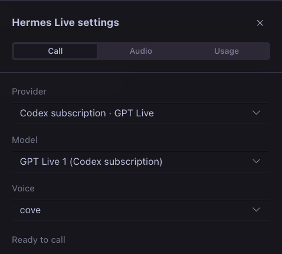
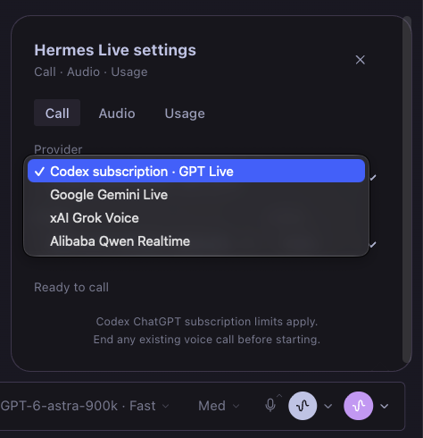
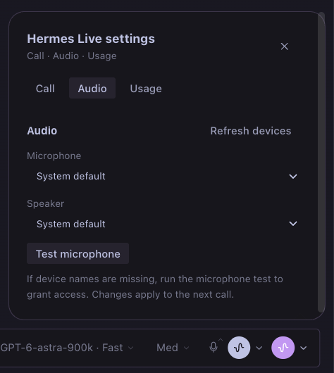
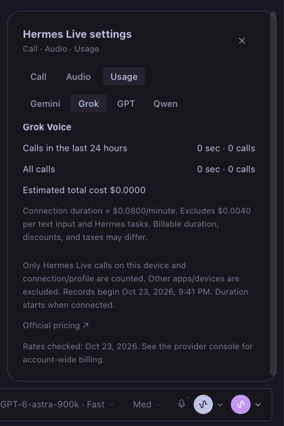
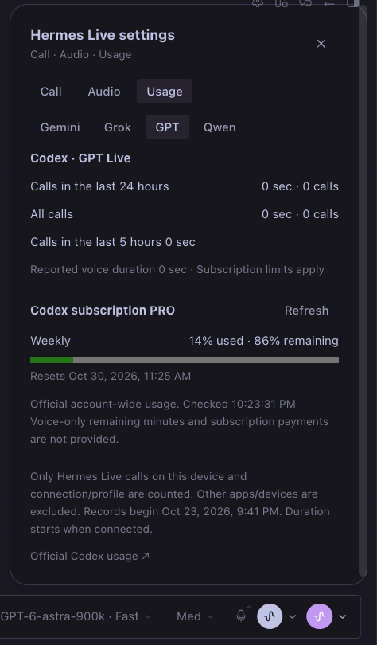

# hermes-live

**Live voice calls with Gemini, Grok, Qwen, and a Codex subscription in Hermes Desktop.**

Korean documentation: [README.ko.md](./README.ko.md)

A plugin that adds a Live call button next to the Hermes Desktop composer without modifying or rebuilding the official app. Its dedicated call panel supports Gemini Live, Grok Voice, Qwen Realtime, and GPT Live through a Codex subscription, with model and voice selection, transcripts, microphone muting, and call controls.

## Preview

The v0.9.0 settings panel uses Hermes Desktop’s native selectors and segmented controls.



An English-interface tour of the installed plugin: account usage, API cost estimates, audio devices, and provider settings. The purple composer button starts a call with saved settings; its adjacent arrow opens this panel.


| Four live voice providers | Microphone and speaker settings |
| --- | --- |
|  |  |
| **API usage and estimated costs** | **Codex subscription limits** |
|  |  |

Captured in Hermes Desktop v0.22.5 with Hermes Live v0.7.0. Usage figures are snapshots, not plan guarantees. The demo shows settings navigation; it does not record a live voice conversation. The interface follows the main app language across all 17 supported languages.

## Requirements

- Hermes Desktop and backend **v0.22.5 or newer**. macOS is verified; Windows and Linux are not yet verified.
- An API key for at least one API provider, or Codex CLI with a ChatGPT subscription login on the backend computer.
- Microphone permission. Node.js 24 is needed only to rebuild the plugin.

## Installation

### Option A — clone and symlink

```sh
git clone https://github.com/dandacompany/hermes-live.git ~/hermes-live
mkdir -p ~/.hermes/plugins
ln -s ~/hermes-live ~/.hermes/plugins/hermes-live
```

Use the symlink command only if that plugin path does not already exist. The repository includes the compiled Desktop entrypoint, so installation does not require a frontend build.

### Option B — install from GitHub

```sh
hermes plugins install dandacompany/hermes-live
```

This is a direct repository install. Catalog admission is pending; installation by the bare catalog name is not yet advertised.

### Verify and enable

```sh
hermes plugins validate ~/.hermes/plugins/hermes-live
hermes plugins enable hermes-live
hermes plugins list
```

In Hermes Desktop, select **Plugins → Rescan**, then enable the **Desktop switch for Hermes Live**. Backend and Desktop activation are separate. Restart the backend after ongoing tasks finish when updating backend routes. Rebuild and reload the Desktop plugin after changing its frontend source.

## GPT Live with a Codex subscription

Select **Codex subscription · GPT Live** as the provider. It supports `gpt-live-1-codex` and nine voices, including cove, juniper, and maple. Instead of requiring an API key as Gemini and Grok do, it uses the **Codex ChatGPT login on the machine running the Hermes backend**.

- Verified with Codex CLI 0.163.0. Run `codex login` on that machine first. API key authentication is rejected for this connection path.
- Subscription usage limits apply. The plugin does not claim to report an exact number of remaining voice minutes for each plan.
- The plugin does not read login files directly or copy or refresh tokens. Codex app-server manages authentication.
- Audio uses WebRTC; transcripts and Hermes task delegation use the v3 data channel.
- Hermes chat executes tasks. Shell access, multi-agent features, apps, plugins, hooks, and inherited MCP servers are disabled in the Codex voice process. This does not guarantee that Codex's internal auxiliary responses consume no usage.
- Ending a call cleans up its app-server process. If the window disappears, heartbeat expiry triggers cleanup of the remaining session within approximately 55 seconds.
- The existing `talk-desktop` plugin is separate. Keep only one of the two calls active at a time. Hermes Live works without `talk-desktop`.
- If an older backend version is already loaded, restart the Hermes backend to load the new `/codex/*` routes. Reloading the Desktop bundle alone does not update the backend.

## Authentication and first call (v0.8.0)

Open **⌄ → Call**, select a provider, then use **Configure API key**. This opens the official Hermes **Plugins → Hermes Live** settings for the current connection and profile. Enter a Gemini, xAI, or Qwen API key in the corresponding masked secret field and save. Qwen also requires the workspace ID and matching region. Configuring one provider is enough; the other keys are optional. Return to the call panel, press **Refresh**, then start the call explicitly.

The panel displays the backend hostname, connection, and profile. A configured key is not proof of provider acceptance: model access, key validity, credits, and limits are checked when connecting. Missing configuration is checked before opening the microphone. Expired or rejected credentials show an error with the setup action available.

Permanent API keys are resolved only by the backend through Hermes's profile-scoped `get_secret`. The renderer receives short-lived tokens or WebRTC signaling responses. The plugin does not read a secret-store token file or invoke a secret-store CLI.

Default lookup order:

| Provider | Hermes secret variables, in priority order |
| --- | --- |
| Gemini | `HERMES_LIVE_GEMINI_API_KEY`, `GEMINI_API_KEY_FOR_LIVE`, `GEMINI_API_KEY`, `GOOGLE_API_KEY` |
| Grok | `HERMES_LIVE_GROK_API_KEY`, `XAI_API_KEY` |
| Qwen | `HERMES_LIVE_QWEN_API_KEY`, `DASHSCOPE_API_KEY` |

Existing secrets can come from Hermes's supported secret sources, including its Bitwarden integration or a user-configured command helper. The optional advanced `*_key_env` settings bind a provider to an exact Hermes secret variable name. An explicit binding overrides the key field and never falls back to another account. Values equal to `PENDING` are unconfigured. To switch to the normal key field, clear that provider's advanced binding.

**Upgrading from v0.7.0:** Move any `*_bws_secret_id` and `bws_token_file` configuration to Hermes's secret-source settings. The plugin no longer accesses Bitwarden directly. A legacy binding without a replacement fails closed and shows migration guidance; it does not silently use another account.

### Codex sign-in and remote connections

Select **Codex subscription · GPT Live**. The panel detects the Codex CLI login on the **backend computer**, distinguishes missing CLI, signed out, API-key login, and a failed check, and shows **Sign-in instructions** with the official guide. Install Codex CLI if needed, run `codex login` in that computer's terminal, and sign in with ChatGPT. On a remote or headless backend, run `codex login --device-auth` there. Return and press **Refresh**. Login does not start a call automatically.

This is a guided CLI login, not an embedded OAuth flow. The plugin never asks you to paste a subscription token. The Hermes app's own ChatGPT login and the Codex CLI account can differ; this voice path uses the latter for both calls and quota. Profiles sharing an OS user and `CODEX_HOME` may share that account.

With a remote Hermes connection, install and enable the backend plugin on that server and configure credentials there. Local Desktop login is not copied to the server. Audio devices remain on the Desktop computer. Routing follows the selected connection/profile and checks for changes before starting. Remote routing is implemented and scope guards are tested; full remote voice-call operation has not yet been verified end to end.

## Usage

**Click the circular Primary-colored button beside the built-in GPT Live controls to start a call immediately with your saved settings.** The adjacent **down arrow** opens provider, live model, and voice settings. During a call, the composer shows a waveform, an **End** button, and a microphone mute control. Before the connection is ready, the button shows **Preparing**; clicking it cancels the connection attempt. Once connected, it changes to **End**. Allow microphone access when macOS asks. Opening or closing the settings panel does not interrupt the call. End the call before changing the provider, model, or voice. Control names below refer to the English interface.

- End any existing GPT Live call before starting. The two call engines are independent.
- API usage is billed to the selected provider account.
- Requests involving actions, files, searches, or other tasks are submitted to the current chat through the `ask_hermes` tool. Existing composer drafts are not overwritten.
- At startup, Codex calls receive information about Hermes's ability to run local tools and its delegation rules. Hermes executes local task requests and returns the results to the voice session.
- Changing the chat, profile, or connection, or disabling the plugin, ends the call.
- Interrupting stops voice playback. Hermes tasks already underway may continue in the chat. Their results are not read aloud after the call ends.
- At call startup, recent user and assistant text from the current chat is sent to the selected voice provider: up to 24 messages and 6,000 characters in total. Hidden messages and tool results are excluded.
- When you delegate a task, the actual utterance and recent voice context are passed to Hermes through the same `voice-live` path as the built-in GPT Live feature. Recent voice context is limited to five minutes, 80 fragments, and 6,000 characters. Task requests and replies remain in the existing chat.
- For a new chat without a session ID, the first request creates the session through the official composer API. That API does not support a separate voice-context field, so context appears in the first message. Subsequent requests use the same separate context field as built-in GPT Live.
- Casual conversation is not saved as individual chat bubbles. Call transcripts are kept only in memory for the duration of the current call.

## Interface languages (v0.7.0)

The plugin follows Hermes Desktop's main **Settings → Appearance → General → Language** setting (`display.language`) through the official plugin SDK. There is no separate plugin language preference. Labels, tooltips, accessibility text, errors, and usage displays update when the app language changes; the call controller is independent of that change. Transcripts and provider voice names remain as received.

All 17 languages in the verified Hermes Desktop v0.22.5 installation are included: Afrikaans, Arabic, Chinese (Simplified and Traditional), English, French, German, Hungarian, Irish, Italian, Japanese, Korean, Portuguese, Russian, Spanish, Turkish, and Ukrainian. Arabic follows the app's right-to-left layout. Numbers, USD amounts, dates, and durations use the selected locale. Additional languages supplied by future or third-party language packs fall back to English until a plugin translation is added.

Verification includes complete translation-key and placeholder coverage, error translation, locale formatting, and call-state preservation tests. The installed app was checked with Korean, English, and Arabic, including English audio/usage panels and Arabic layout. This does not claim native-speaker review of every translation or a real voice call during language switching.

## Audio and usage (v0.5.0)

Choose a microphone and speaker under **⌄ → Audio** to the right of the Live button. Device choices are saved on this machine and applied to the next call. **Microphone test** displays only the input level for up to 15 seconds. Stopping the test, closing the menu, or starting a call releases the test microphone; audio is neither recorded nor sent to a server. If a selected device has been removed, choose another device. Output device switching requires support for `AudioContext.setSinkId`.

View Gemini, Grok, Qwen, and GPT separately under **⌄ → Usage**.

- **All providers**: Shows call duration and count for the last 24 hours and all time, covering calls connected on this device and the current connection/profile since installing this version. Preparation time is excluded. Only usage figures are stored locally, with updates every five seconds during a call; a forced shutdown may lose the last few seconds. Usage from earlier versions, other apps, or other devices is not collected retroactively.
- **Gemini**: Shows server-reported input/output tokens and estimated USD costs based on standard paid rates. When breakdowns are missing or costs such as thinking or cached tokens cannot be determined, those portions are excluded and marked **Unpriced usage**. This is not an actual bill; free allowances, discounts, taxes, and delegated Hermes task costs are excluded.
- **Grok**: Estimates voice costs as connection duration × $0.08/minute. The $0.004 charge per text input and Hermes task costs are excluded. Actual billable time may differ from connection duration.
- **GPT / Codex**: Alongside local voice duration, retrieves the **plan, official usage percentage, remaining percentage, and reset time** for the Codex-managed account used for calls. These are account-wide figures; they are not converted into voice-only remaining minutes or a monthly subscription charge. Use Refresh to retrieve updated values.

Rates checked on 2026-10-23: [Gemini pricing](https://ai.google.dev/gemini-api/docs/pricing), [xAI pricing](https://docs.x.ai/developers/pricing). Check the provider console for account-wide billing. This version adds the `/codex/usage` backend API. If an older backend is running, restart the gateway after ongoing tasks finish.

## Building and verification

The public source includes TypeScript, Python, the lockfile, and the compiled Desktop entrypoint. Rebuild with Node.js 24:

```sh
npm ci
npm run typecheck
npm run build
hermes plugins validate . --install-deps
```

The build workflow checks types and confirms that rebuilding produces the committed bundle. Live provider checks use paid accounts and are not run by that workflow.

Verification on 2026-10-23: Chrome tests with synthetic input confirmed WebRTC connectivity, Korean transcripts, and non-silent audio reception using a Codex ChatGPT Pro account. No physical microphone recording or speaker playback was performed. Real short-lived token issuance, WebSocket setup, and Korean audio reception succeeded for Gemini 3.8 Live, Gemini 3.1 Flash Live Preview, and Gemini 2.5 Flash Native Audio. Grok passed real short-lived token, WebSocket setup, Korean voice response, and seeded-context recall checks. For Codex, synthetic voice input in the installed Desktop app also verified actual storage inspection by Hermes and return of the result to the voice session. Final conversation testing with a physical microphone and speakers remains separate.

## Extending providers

Each provider requires backend token issuance, an allowed-model catalog, and realtime protocol handling in `src/providers.ts`. Adding an ordinary text model or an arbitrary OpenAI-compatible URL alone does not enable realtime voice.

API references: [Gemini Live](https://ai.google.dev/gemini-api/docs/live-api), [Gemini REST](https://ai.google.dev/api/live), [xAI Voice](https://docs.x.ai/developers/model-capabilities/audio/speech-to-speech).

## Qwen Realtime (v0.6.0)

Select `qwen3.8-omni-flash-realtime` under **Alibaba Qwen Realtime**. The default voice is `Sohee`, which supports Korean; Tina, Cindy, and Raymond are also available. Calls, microphone and speaker selection, transcripts, recent chat context, and Hermes task delegation use the existing UI.

Find your region-specific API key and **Workspace ID** in Model Studio. Use **Configure API key** in the call panel to enter the Qwen key in Hermes settings. Set the workspace and region there, or use the non-secret commands below.

```sh
hermes config set plugins.entries.hermes-live.settings.qwen_workspace_id <workspace-id>
hermes config set plugins.entries.hermes-live.settings.qwen_region singapore
```

`qwen_region` must be `singapore` or `beijing` and must match the region where the key was issued. Key permissions can be restricted to `qwen3.8-omni-flash-realtime`. Access to ordinary Qwen text models alone does not enable calls.

The backend exchanges only SDP with the official workspace-specific `/api/v1/webrtc/realtime` endpoint. Long-lived keys are not passed to the browser, and audio travels over WebRTC. Microphone transmission starts only after the server acknowledges configuration with `session.updated`. An already-running Hermes backend must be restarted to load the new `/qwen/session` route after updating the setup.

Usage aggregates input and output tokens per response and applies rates for the connection region. Qwen3.8 charges for **both audio output and its corresponding text output**. Estimates exclude free allowances, discounts, taxes, and Hermes task costs. Missing token breakdowns are marked as unpriced usage. Existing Gemini, Grok, and GPT usage records are preserved.

Official references: [Realtime connections and WebRTC](https://www.alibabacloud.com/help/en/model-studio/realtime), [client events](https://www.alibabacloud.com/help/en/model-studio/client-events), [server events](https://www.alibabacloud.com/help/en/model-studio/server-events), [model and pricing](https://www.alibabacloud.com/help/en/model-studio/qwen3-8-omni-flash-realtime), [voices](https://www.alibabacloud.com/help/en/model-studio/omni-voice-list).

Verification status: In addition to automated tests, a real Singapore server test confirmed WebRTC connectivity, Sohee configuration, transcription of recorded Korean input, an `ask_hermes` call containing chat context, a Korean response to a test tool result, and receipt of audio packets and detailed token usage. Physical microphone and speaker quality, and the complete path from Qwen to actual Hermes task execution, still require separate verification.

## Security and limitations

Microphone audio and recent chat text are sent to the selected voice provider. Gemini uses `generativelanguage.googleapis.com`; Grok uses `api.x.ai`; Qwen uses the workspace endpoint under `maas.aliyuncs.com`; Codex negotiates its subscription voice connection through the installed Codex app-server and provider WebRTC service. WebRTC media destinations are negotiated by the provider. Task requests and recent voice context go to the selected Hermes backend.

The plugin stores device choices, provider selections, and usage totals in Desktop plugin storage. It keeps transcripts in memory; it does not record raw audio, persist API keys itself, or add telemetry. Keys entered in the official settings are managed by Hermes. Codex runs a child app-server with a temporary working directory; it uses the backend user's Codex configuration and login. Call end cleans it up; lost-window cleanup is described above.

If Hermes pauses a delegated task to ask the user a question, voice may keep waiting until the task finishes or times out. Answer in the chat. This is a known limitation of the current task bridge.

Catalog admission is not yet confirmed. The API-key path uses official Hermes secret resolution; the Codex app-server authentication and quota path still needs catalog-maintainer policy review or a separately verified migration to Hermes-owned subscription authentication.

Authentication update verification: 53 Node tests, 26 Python tests, Hermes request-contract checks, TypeScript checks, and all 16 plugin validation checks pass. The installed Desktop app was checked for subscription detection and navigation to the official masked API-key form. Missing-login states use test fixtures; no existing account was signed out.

## Desktop design system (v0.9.0)

Provider, model, voice, and audio-device selectors use the official Hermes SDK Select. Call, Audio, and Usage share the app's segmented control, popover surface, typography, and theme colors. The model field uses the full panel width. Authentication actions align with their section heading; longer sign-in instructions expand on demand. The header and notice stay in place while long content scrolls inside the panel.

## License

Hermes Live is licensed under the [MIT License](LICENSE). Required third-party notices are included in [NOTICE.md](NOTICE.md).

---
Built by [Dante Labs](https://dante-labs.com) · [YouTube @dante-labs](https://youtube.com/@dante-labs) · [Email](mailto:dante@dante-labs.com) · [Discord](https://discord.com/invite/rXyy5e9ujs) · [Support](https://buymeacoffee.com/dante.labs)
